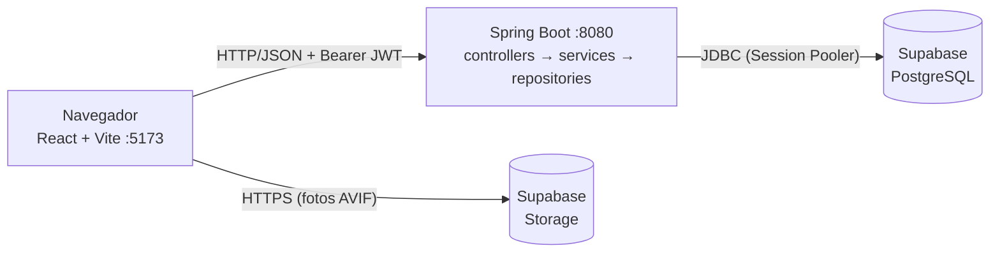

<!-- README elaborado a partir do template do Prof. Dr. João Paulo Aramuni -->

---

# 🚗 Getaway Car Rentals 🔑

> [!NOTE]
> Sistema web para gestão de aluguéis de automóveis: clientes solicitam, modificam e cancelam pedidos pela Internet, e agentes (bancos e empresas) analisam o pedido do ponto de vista financeiro e concedem crédito.

<table>
  <tr>
    <td width="800px">
      <div align="justify">
        O <b>Getaway Car Rentals</b> é o protótipo desenvolvido no <b>Laboratório 02</b> da disciplina <b>Desenvolvimento e Integração de Aplicações Web (DIAW)</b>, do curso de Engenharia de Software da PUC Minas. Ele reúne um <i>back-end em Spring Boot</i> (arquitetura MVC, autenticação JWT), um <i>front-end em React + Vite</i> e um banco <i>PostgreSQL no Supabase</i>. O cliente escolhe um carro em um catálogo com fotos, acompanha o status do pedido e o agente avalia, aprova ou reprova e, sendo banco, concede o contrato de crédito.
      </div>
    </td>
    <td>
      <div>
        
      </div>
    </td>
  </tr>
</table>

---

## 🚧 Status do Projeto

      

---

## 📚 Índice
- [Links Úteis](#-links-úteis)
- [Sobre o Projeto](#-sobre-o-projeto)
- [Funcionalidades Principais](#-funcionalidades-principais)
- [Tecnologias Utilizadas](#-tecnologias-utilizadas)
- [Arquitetura](#-arquitetura)
- [Instalação e Execução](#-instalação-e-execução)
  - [Pré-requisitos](#pré-requisitos)
  - [Variáveis de Ambiente](#-variáveis-de-ambiente)
  - [Instalação de Dependências](#-instalação-de-dependências)
  - [Banco de Dados (Supabase)](#-banco-de-dados-supabase)
  - [Fotos dos Carros (Supabase Storage)](#-fotos-dos-carros-supabase-storage)
  - [Como Executar a Aplicação](#-como-executar-a-aplicação)
- [Deploy](#-deploy)
- [Estrutura de Pastas](#-estrutura-de-pastas)
- [API REST](#-api-rest)
- [Demonstração](#-demonstração)
- [Testes](#-testes)
- [Modelagem (UML)](#-modelagem-uml)
- [Documentações utilizadas](#-documentações-utilizadas)
- [Autores](#-autores)
- [Contribuição](#-contribuição)
- [Agradecimentos](#-agradecimentos)
- [Licença](#-licença)

---

## 🔗 Links Úteis
* 📖 **Modelagem UML:** [`docs/`](./docs) (casos de uso, histórias de usuário, classes e pacotes)
* 💾 **Script do banco:** [`docs/banco.sql`](./docs/banco.sql)
* 🌐 **Demo Online:** não publicada (execução local, veja [Como Executar](#-como-executar-a-aplicação))

---

## 📝 Sobre o Projeto

**Por que existe:** o enunciado do Laboratório 02 pede um sistema de apoio à gestão de aluguéis de automóveis que permita efetuar, cancelar e modificar pedidos através da Internet.

**Qual problema resolve:** centraliza em um só lugar o pedido do cliente, a análise financeira feita por bancos e empresas e a concessão de crédito, antes feitos de forma dispersa.

**Contexto:** acadêmico, disciplina DIAW (2º período, Engenharia de Software, PUC Minas).

**Como funciona:**

1. O usuário se cadastra como **Cliente** (com RG, CPF, nome, endereço, profissão e até 3 empregadores com rendimentos) ou como **Agente** (banco ou empresa) e faz login.
2. O cliente navega pelo catálogo de 15 carros, escolhe um e cria um pedido, que nasce como `Pendente`.
3. O agente vê os pedidos com os dados financeiros do cliente e os **aprova** ou **reprova**.
4. Se o agente for um **Banco**, ele pode **conceder crédito** para um pedido aprovado, gerando um contrato de crédito.
5. O cliente acompanha o status e o contrato em "Meus pedidos".

---

## ✨ Funcionalidades Principais

- 🔐 **Autenticação segura:** cadastro e login com senha em BCrypt e token JWT (2 horas).
- 👥 **Dois perfis com permissões distintas:** Cliente e Agente, aplicadas no back-end (`@PreAuthorize`) e no front-end (rotas protegidas).
- 🚘 **Catálogo de carros com 5 fotos cada:** frente, traseira, lateral e duas diagonais.
- 📝 **Pedidos de aluguel:** criar, consultar, modificar (trocar o carro) e cancelar, enquanto `Pendente`.
- 🏦 **Painel do agente:** filtro por status, dados do cliente, empregadores, renda total, aprovar e reprovar.
- 💳 **Contrato de crédito:** concedido apenas por agente do tipo Banco, para pedido aprovado, um contrato por pedido.
- 🧑‍💼 **CRUD de cliente:** restrito ao perfil Agente, com limite de 3 empregadores.
- 🛡️ **Regras de integridade no banco:** constraints para tipos, status e unicidade.

---

## 🛠 Tecnologias Utilizadas

### 💻 Front-end

* **Biblioteca:** React
* **Build Tool:** Vite
* **Roteamento:** React Router DOM
* **Linguagem:** JavaScript (ES6+)
* **Estilização:** CSS puro (`src/index.css`)
* **Gerenciamento de Estado:** Context API (sessão de autenticação)
* **Qualidade:** ESLint

### 🖥️ Back-end

* **Linguagem:** Java 25 (JDK 25)
* **Framework:** Spring Boot 4.0.x (Spring Web MVC)
* **Build e dependências:** Apache Maven (Maven Wrapper)
* **Banco de Dados:** PostgreSQL 17 (Supabase)
* **ORM:** Spring Data JPA / Hibernate 7
* **Autenticação:** Spring Security + JWT (Nimbus, HS256) + BCrypt
* **JSON:** Jackson (`jackson-databind`), necessário para a coluna `jsonb`

### ☁️ Infraestrutura

* **Banco e armazenamento:** Supabase (PostgreSQL via *Session Pooler* e Storage para as fotos)
* **Versionamento:** Git e GitHub

---

## 🏗 Arquitetura

O sistema segue a arquitetura **MVC em camadas** no back-end e é dividido em dois subsistemas, como pede o enunciado: **gestão de pedidos e contratos** (back-end) e **construção dinâmica das páginas web** (front-end).

- **Model:** entidades JPA (`models`), espelhando as tabelas do Supabase.
- **View:** aplicação React, que consome a API REST em JSON.
- **Controller:** controllers REST (`controllers`), que aplicam as regras de acesso por perfil.
- **Service:** regras de negócio (`services`): limite de 3 rendimentos, ciclo de vida do pedido, posse do pedido, concessão de crédito.
- **Repository:** acesso a dados com Spring Data JPA (`repositories`).
- **DTOs:** `record`s Java para entrada e saída de login e cadastro.

**Decisões importantes:**

- O front-end **nunca** acessa o banco: toda a comunicação passa pela API Spring Boot.
- O schema é gerenciado no Supabase (`ddl-auto=none`); o Hibernate não altera as tabelas.
- Sessão **stateless** com JWT; o perfil viaja dentro do token (`ROLE_CLIENTE` ou `ROLE_AGENTE`).
- Fotos fora do Git: ficam no **Supabase Storage** e são montadas pela matrícula do carro.
- Segredos somente em variáveis de ambiente.

**Fluxo de dados (visão geral):**



Os diagramas completos (casos de uso, classes, pacotes e sequência) estão em [`docs/`](./docs) e listados em [Modelagem (UML)](#-modelagem-uml).

---

## 🔧 Instalação e Execução

### Pré-requisitos

* **Java JDK 25**
* **Node.js** 20 ou superior (desenvolvido com Node 24) e **npm**
* **Git**
* Uma conta gratuita no **[Supabase](https://supabase.com)**

---

### 🔑 Variáveis de Ambiente

#### 1. Back-end (Spring Boot)

Defina como variáveis de ambiente do sistema ou da sessão do terminal. **Nunca** coloque esses valores no repositório.

| Variável | Descrição | Exemplo |
| :--- | :--- | :--- |
| `SUPABASE_DB_PASSWORD` | Senha do banco (definida ao criar o projeto no Supabase). | `minha-senha-do-banco` |
| `JWT_SECRET` | Chave de assinatura dos tokens, **mínimo 32 caracteres**. | `uma-frase-longa-com-mais-de-32-caracteres` |

O host e o usuário do banco ficam em `backend/src/main/resources/application.properties`. Ajuste para o **seu** projeto Supabase (em **Connect → Session pooler**):

```properties
spring.datasource.url=jdbc:postgresql://<HOST_DO_POOLER>:5432/postgres?sslmode=require
spring.datasource.username=postgres.<REF_DO_PROJETO>
spring.datasource.password=${SUPABASE_DB_PASSWORD}
app.jwt.secret=${JWT_SECRET}
```

PowerShell (sessão atual):

```powershell
$env:SUPABASE_DB_PASSWORD = "sua_senha_do_banco"
$env:JWT_SECRET = "uma-frase-longa-com-mais-de-32-caracteres"
```

Linux/macOS:

```bash
export SUPABASE_DB_PASSWORD="sua_senha_do_banco"
export JWT_SECRET="uma-frase-longa-com-mais-de-32-caracteres"
```

> [!TIP]
> No Windows, crie `backend/rodar.ps1` com as duas linhas acima seguidas de `.\mvnw spring-boot:run`. O arquivo está no `.gitignore` e **não deve ser versionado**.

#### 2. Front-end (React, Vite)

Crie `frontend/.env` (veja `frontend/.env.example`). O prefixo `VITE_` é obrigatório.

| Variável | Descrição | Exemplo |
| :--- | :--- | :--- |
| `VITE_FOTOS_URL` | URL pública do bucket `carros` no Supabase Storage. | `https://<REF_DO_PROJETO>.supabase.co/storage/v1/object/public/carros` |
| `VITE_API_URL` | (Opcional) URL base do back-end, **sem** `/api`. Padrão: `http://localhost:8080`. | `http://localhost:8080` |

> O Vite só lê o `.env` ao iniciar: reinicie o `npm run dev` após alterá-lo.

---

### 📦 Instalação de Dependências

```bash
git clone https://github.com/Cesarlac/getaway-car-rentals.git
cd getaway-car-rentals
```

**Front-end:**

```bash
cd frontend
npm install
cd ..
```

**Back-end:**

```bash
cd backend
./mvnw clean install -DskipTests
cd ..
```

(No Windows, use `.\mvnw`.)

---

### 💾 Banco de Dados (Supabase)

1. Crie um projeto no Supabase e guarde a senha do banco.
2. Abra o **SQL Editor** e execute o script [`docs/banco.sql`](./docs/banco.sql). Ele cria as 6 tabelas, as constraints e os 15 carros do catálogo.
3. Confira em **Table Editor** que as tabelas existem e que `automoveis` tem 15 linhas.

> [!NOTE]
> O Hibernate está com `ddl-auto=none`: o schema **não** é criado pela aplicação. Os valores aceitos têm **primeira letra maiúscula**: `Banco`/`Empresa` (agentes), `Cliente`/`Empresa`/`Banco` (proprietário do carro), `Pendente`/`Aprovado`/`Reprovado`/`Cancelado` (pedido).

**Modelo de dados:**

| Tabela | Descrição |
|---|---|
| `clientes` | Dados de identificação, profissão e `empregadores_rendimentos` (`jsonb`, máx. 3). |
| `agentes` | Bancos e empresas. |
| `automoveis` | Matrícula, placa, marca, modelo, ano e tipo de proprietário. |
| `pedidos_aluguel` | Cliente, automóvel, status financeiro e data de criação. |
| `contratos_credito` | Pedido, banco agente e data de concessão (um por pedido). |
| `usuarios` | Login, hash BCrypt, perfil e vínculo com cliente ou agente. |

---

### 🖼️ Fotos dos Carros (Supabase Storage)

As fotos **não** ficam no Git. Cada carro tem 5 imagens `.avif`, em uma pasta com o nome da matrícula:

```
bucket "carros" (público)
├── MAT-001/  frente.avif · frente-lateral.avif · lateral.avif · traseira-lateral.avif · traseira.avif
├── MAT-002/  ...
└── MAT-015/  ...
```

1. No Supabase, vá em **Storage → New bucket**, nome `carros`, marque **Public bucket**.
2. Envie as 15 pastas (`MAT-001` a `MAT-015`).
3. Teste no navegador: `https://<REF_DO_PROJETO>.supabase.co/storage/v1/object/public/carros/MAT-001/frente.avif`.
4. Coloque a URL base em `VITE_FOTOS_URL`.

Sem as fotos o sistema funciona, mas as imagens aparecem quebradas.

---

### ⚡ Como Executar a Aplicação

Use **dois terminais**.

#### Terminal 1: Back-end (Spring Boot)

```bash
cd backend
./mvnw spring-boot:run
```

🚀 Aguarde `Started DemoApplication`. O back-end estará em **http://localhost:8080**.

#### Terminal 2: Front-end (React, Vite)

```bash
cd frontend
npm run dev
```

🎨 O front-end estará em **http://localhost:5173**.

#### Primeiro acesso

1. Abra `http://localhost:5173/cadastro` e crie um **Cliente**.
2. Crie também um **Agente** do tipo **Banco** (para avaliar pedidos e conceder crédito).
3. Entre como cliente, escolha um carro e solicite o aluguel.
4. Entre como agente, aprove o pedido e conceda o crédito.

---

## 🚀 Deploy

O projeto roda localmente. Para publicar:

```bash
# Front-end: gera frontend/dist (arquivos estáticos)
cd frontend
npm run build

# Back-end: gera backend/target/aluguel-carros-0.0.1-SNAPSHOT.jar
cd ../backend
./mvnw clean package

# Execução do JAR
java -jar target/aluguel-carros-0.0.1-SNAPSHOT.jar
```

Em produção, defina `SUPABASE_DB_PASSWORD` e `JWT_SECRET` no provedor, aponte `VITE_API_URL` para a URL pública do back-end e **ajuste a origem permitida no CORS** (`config/SecurityConfig.java`, hoje `http://localhost:5173`).

---

## 📂 Estrutura de Pastas

```
getaway-car-rentals/
├── README.md                     # 📘 Documentação principal.
├── .gitignore                    # 🧹 Ignora target, node_modules, .env, rodar.ps1.
│
├── docs/                         # 📚 Modelagem e banco
│   ├── 01-casos-de-uso.md
│   ├── 02-historias-de-usuario.md
│   ├── 03-diagrama-de-classes.md
│   ├── 04-diagrama-de-pacotes.md
│   ├── banco.sql                 # 💾 Script de criação das tabelas e dos carros.
│   └── logo.svg
│
├── backend/                      # 📁 Spring Boot (MVC)
│   ├── pom.xml
│   ├── mvnw / mvnw.cmd
│   └── src/main/
│       ├── java/com/example/demo/
│       │   ├── DemoApplication.java
│       │   ├── config/           # 🔧 SecurityConfig: JWT, BCrypt, CORS.
│       │   ├── controllers/      # 🎮 Auth, Cliente, Pedido, Automovel, Contrato (+ AuthDtos).
│       │   ├── services/         # ⚙️ AuthService, ClienteService, PedidoService, ContratoService.
│       │   ├── repositories/     # 🗄️ 6 interfaces JpaRepository.
│       │   └── models/           # 🧬 Cliente, Rendimento, Agente, Automovel, PedidoAluguel, ContratoCredito, Usuario.
│       └── resources/application.properties
│
└── frontend/                     # 📁 React + Vite
    ├── .env.example
    ├── package.json
    └── src/
        ├── main.jsx · App.jsx    # 🚪 Entrada e rotas.
        ├── api.js                # 🔌 Único ponto de chamada HTTP (injeta o JWT).
        ├── fotos.js · perfil.js  # 🛠️ URL das fotos e checagem de perfil.
        ├── auth/                 # 🔐 AuthContext e AuthProvider.
        ├── components/           # 🧱 Layout, Menu, ProtectedRoute, RotaPorPerfil.
        ├── pages/                # 📄 Login, Cadastro, Inicio, Catalogo, CarroDetalhe, MeusPedidos, Painel.
        └── index.css             # 🎨 Estilos globais.
```

---

## 🌐 API REST

Base: `http://localhost:8080`. Exceto as rotas públicas, envie `Authorization: Bearer <token>`.

| Método | Rota | Perfil | Descrição |
|---|---|---|---|
| POST | `/api/auth/registrar` | público | Cadastra cliente ou agente. |
| POST | `/api/auth/login` | público | Devolve `token` e `perfil`. |
| GET | `/api/me` | logado | Login e perfil do token. |
| GET | `/api/automoveis` | logado | Catálogo de carros. |
| POST | `/api/pedidos` | Cliente | Cria pedido (`{"automovelId": "..."}`). |
| GET | `/api/pedidos/meus` | Cliente | Pedidos do cliente. |
| GET | `/api/pedidos/{id}` | Cliente | Consulta um pedido próprio. |
| PUT | `/api/pedidos/{id}` | Cliente | Troca o carro (só `Pendente`). |
| PUT | `/api/pedidos/{id}/cancelar` | Cliente | Cancela (só `Pendente`). |
| GET | `/api/pedidos` | Agente | Lista todos os pedidos. |
| PUT | `/api/pedidos/{id}/avaliacao` | Agente | `{"status": "Aprovado" \| "Reprovado"}`. |
| POST | `/api/contratos` | Agente (Banco) | Concede crédito (`{"pedidoId": "..."}`). |
| GET | `/api/contratos` | Agente | Lista contratos. |
| GET | `/api/contratos/meus` | Cliente | Contratos do cliente. |
| GET/POST/PUT/DELETE | `/api/clientes[/{id}]` | Agente | CRUD de cliente. |

Códigos de erro: `400` dados inválidos · `401` não autenticado · `403` sem permissão · `404` não encontrado · `409` estado não permite a operação.

---

## 🎥 Demonstração

> Adicione as capturas de tela em `docs/img/` e referencie abaixo.

| Tela | Captura de Tela |
| :---: | :---: |
| **Login** | **Cadastro** |
|  |  |
| **Catálogo** | **Detalhe do carro** |
|  |  |
| **Meus pedidos (cliente)** | **Painel do agente** |
|  |  |

### 💻 Exemplo de saída no Terminal (API)

```powershell
$r = Invoke-RestMethod -Method Post -Uri http://localhost:8080/api/auth/login `
  -ContentType "application/json" -Body '{"login":"joao","senha":"123456"}'
Invoke-RestMethod http://localhost:8080/api/me -Headers @{Authorization="Bearer $($r.token)"}
```

**Saída esperada:**
```text
perfil  login
------  -----
CLIENTE joao
```

---

## 🧪 Testes

O projeto **não possui testes automatizados**. A validação foi feita manualmente via API (PowerShell) e pelo navegador, cobrindo:

| Cenário | Resultado esperado |
|---|---|
| Rota protegida sem token | `401` |
| Cliente acessando rota de agente (`GET /api/pedidos`, `GET /api/clientes`) | `403` |
| Agente criando pedido | `403` |
| Cancelar ou avaliar pedido já avaliado | `409` |
| Crédito em pedido `Pendente` | `409` |
| Empresa ou cliente concedendo crédito | `403` |
| Segundo contrato no mesmo pedido | `409` |
| Cliente inexistente | `404` |
| Mais de 3 empregadores | `400` |

Para rodar os testes gerados pelo Spring (apenas o *context load*):

```bash
cd backend
./mvnw test
```

---

## 📐 Modelagem (UML)

| Artefato | Arquivo |
|---|---|
| Diagrama de Casos de Uso | [`docs/01-casos-de-uso.md`](./docs/01-casos-de-uso.md) |
| Histórias do Usuário | [`docs/02-historias-de-usuario.md`](./docs/02-historias-de-usuario.md) |
| Diagrama de Classes | [`docs/03-diagrama-de-classes.md`](./docs/03-diagrama-de-classes.md) |
| Diagrama de Pacotes (Visão Lógica) | [`docs/04-diagrama-de-pacotes.md`](./docs/04-diagrama-de-pacotes.md) |

Os diagramas são escritos em **Mermaid** e renderizam diretamente no GitHub.

---

## 🔗 Documentações utilizadas

* 📖 [Spring Boot](https://docs.spring.io/spring-boot/index.html)
* 📖 [Spring Security: OAuth2 Resource Server (JWT)](https://docs.spring.io/spring-security/reference/servlet/oauth2/resource-server/jwt.html)
* 📖 [Spring Data JPA](https://docs.spring.io/spring-data/jpa/reference/)
* 📖 [React](https://react.dev/reference/react) e [React Router](https://reactrouter.com/)
* 📖 [Vite](https://vitejs.dev/config/)
* 📖 [Supabase: Database](https://supabase.com/docs/guides/database) e [Storage](https://supabase.com/docs/guides/storage)
* 📖 [Mermaid](https://mermaid.js.org/)
* 📖 [Conventional Commits](https://www.conventionalcommits.org/en/v1.0.0/)

---

## 👥 Autores

| 👤 Nome | :octocat: GitHub |
|---------|-----------------|
| Cesar | [@Cesarlac](https://github.com/Cesarlac) |

---

## 🤝 Contribuição

1. Faça um `fork` do projeto.
2. Crie uma branch (`git checkout -b feature/minha-feature`).
3. Commit suas mudanças (`git commit -m 'feat: descrição'`), seguindo o [Conventional Commits](https://www.conventionalcommits.org/en/v1.0.0/).
4. Faça o `push` (`git push origin feature/minha-feature`).
5. Abra um **Pull Request**.

---

## 🙏 Agradecimentos

* [**Engenharia de Software PUC Minas**](https://www.instagram.com/engsoftwarepucminas/): pelo apoio institucional e estrutura acadêmica.
* [**Prof. Dr. João Paulo Aramuni**](https://github.com/joaopauloaramuni): pelos ensinamentos da disciplina e pelo template de documentação.

---

## 📄 Licença

Projeto acadêmico desenvolvido para a disciplina DIAW (PUC Minas), sem fins comerciais. Para uso aberto, adicione um arquivo `LICENSE` (por exemplo, MIT) à raiz.

---
