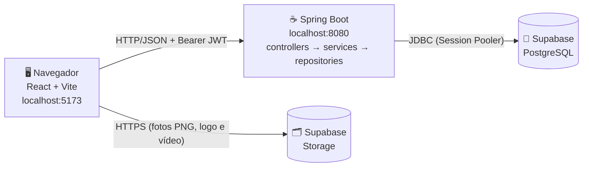
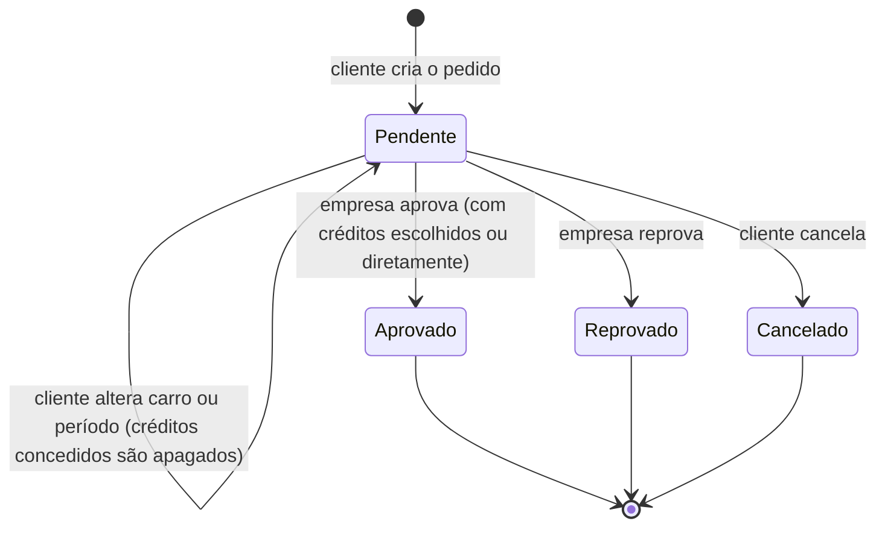
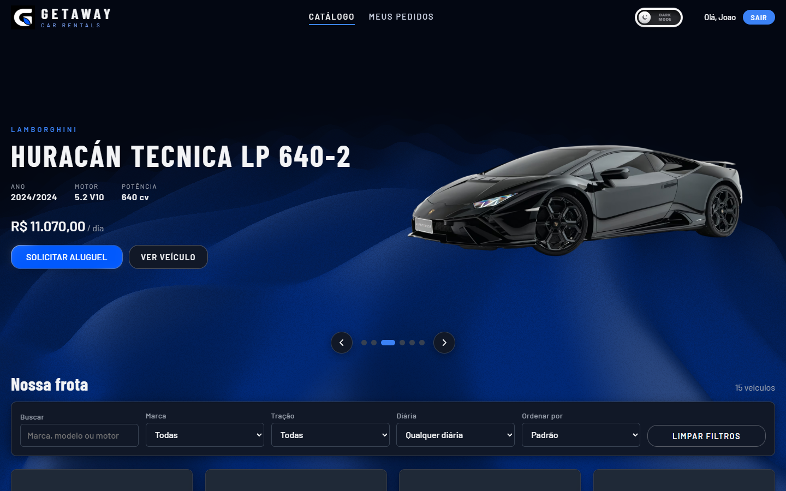
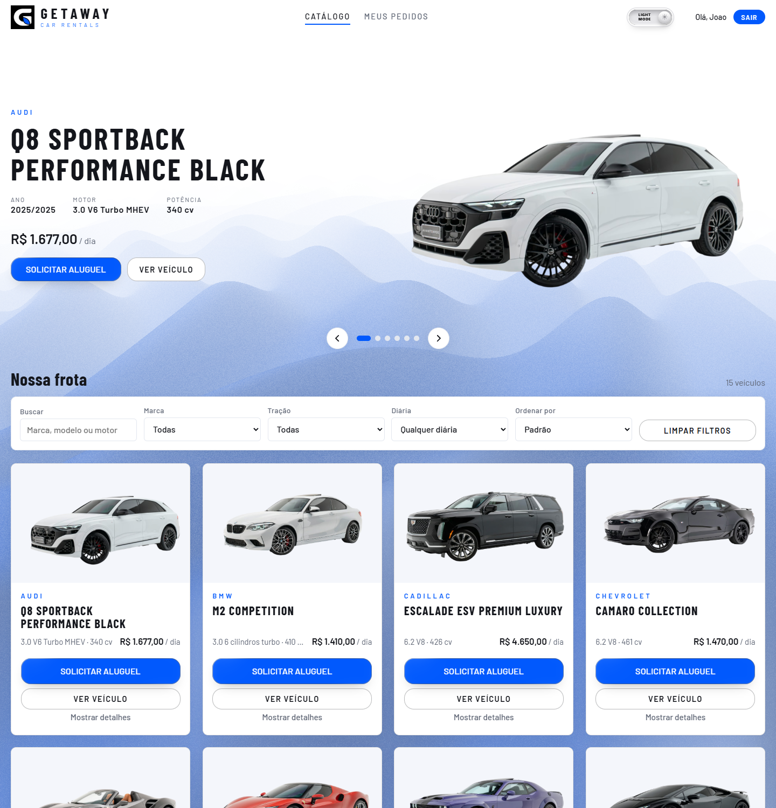
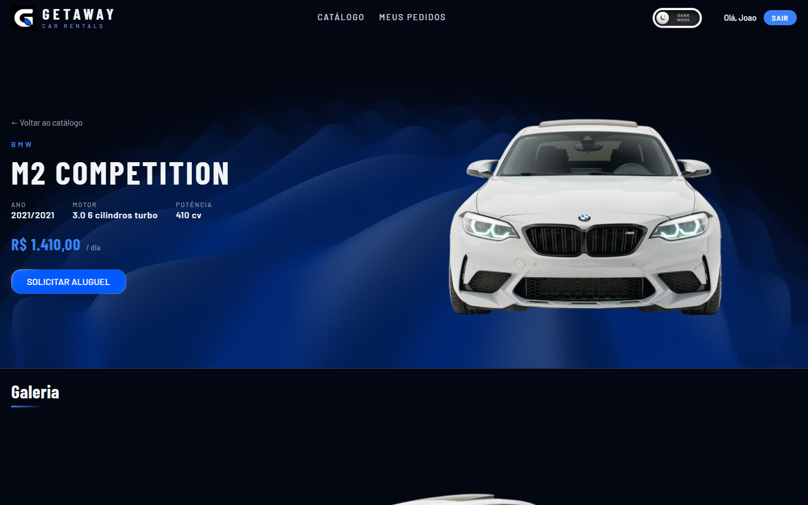
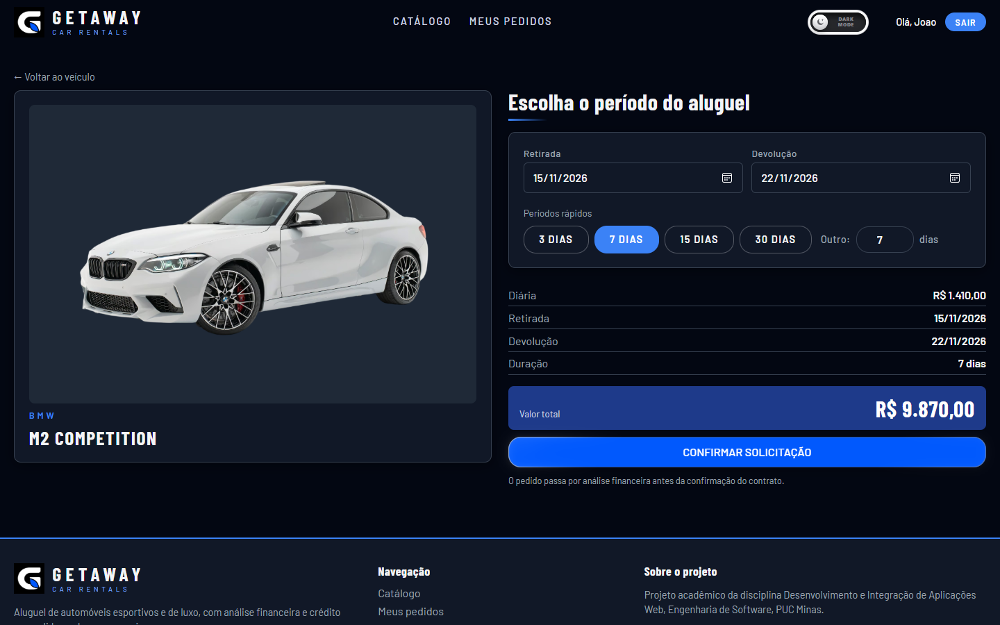
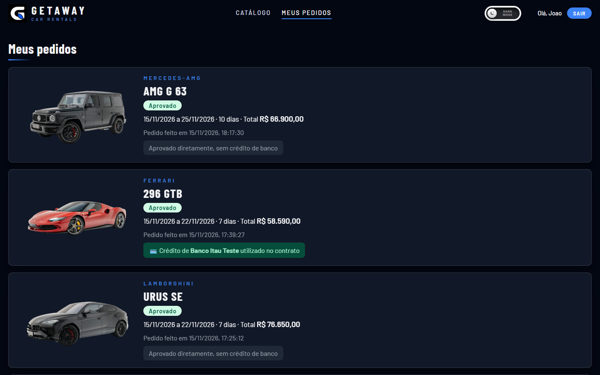
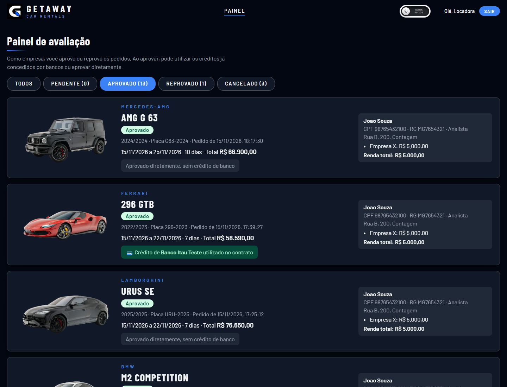
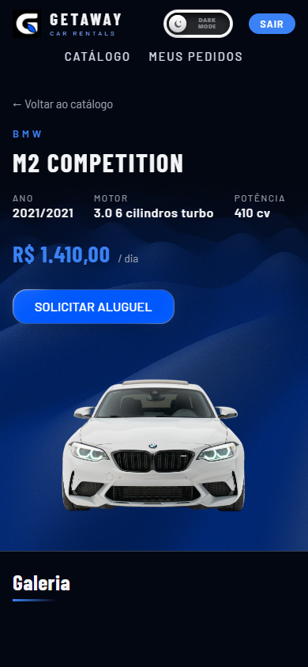

<!-- README elaborado a partir do template do Prof. Dr. João Paulo Aramuni -->

---

# 🚗 Getaway Car Rentals 🔑

> [!NOTE]
> Sistema web de aluguel de carros esportivos e de luxo: o cliente escolhe o carro e o período pela Internet, os bancos concedem crédito e as empresas aprovam ou reprovam o pedido.

<table>
  <tr>
    <td width="800px">
      <div align="justify">
        O <b>Getaway Car Rentals</b> é o protótipo desenvolvido no <b>Laboratório 02</b> da disciplina <b>Desenvolvimento e Integração de Aplicações Web (DIAW)</b>, do curso de Engenharia de Software da PUC Minas. Ele reúne um <i>back-end em Spring Boot</i> (arquitetura MVC, autenticação JWT), um <i>front-end em React + Vite</i> e um banco <i>PostgreSQL no Supabase</i>. O cliente navega por um catálogo com fotos e ficha técnica, escolhe o período, vê o valor total e acompanha o pedido. Do outro lado, os <b>bancos</b> concedem crédito aos pedidos pendentes e as <b>empresas</b> fazem a avaliação, decidindo se usam os créditos concedidos ou se aprovam diretamente.
      </div>
    </td>
    <td>
      <div>
        
      </div>
    </td>
  </tr>
</table>

---

## 🚧 Status do Projeto

         

---

## 📚 Índice
- [Links Úteis](#-links-úteis)
- [Sobre o Projeto](#-sobre-o-projeto)
- [Funcionalidades Principais](#-funcionalidades-principais)
- [Tecnologias Utilizadas](#-tecnologias-utilizadas)
- [Arquitetura](#-arquitetura)
  - [Fluxo do pedido](#fluxo-do-pedido)
  - [Como o front-end se conecta ao back-end](#como-o-front-end-se-conecta-ao-back-end)
- [Instalação e Execução](#-instalação-e-execução)
  - [Pré-requisitos](#pré-requisitos)
  - [Variáveis de Ambiente](#-variáveis-de-ambiente)
  - [Instalação de Dependências](#-instalação-de-dependências)
  - [Banco de Dados (Supabase)](#-banco-de-dados-supabase)
  - [Fotos, logo e vídeo (Supabase Storage)](#️-fotos-logo-e-vídeo-supabase-storage)
  - [Como Executar a Aplicação](#-como-executar-a-aplicação)
- [Deploy](#-deploy)
- [Estrutura de Pastas](#-estrutura-de-pastas)
- [API REST](#-api-rest)
- [Demonstração](#-demonstração)
- [Efeitos visuais do React Bits](#-efeitos-visuais-do-react-bits)
- [Testes](#-testes)
- [Limitações conhecidas](#️-limitações-conhecidas)
- [Problemas comuns](#️-problemas-comuns)
- [Modelagem (UML)](#-modelagem-uml)
- [Documentações utilizadas](#-documentações-utilizadas)
- [Créditos de imagens, vídeo e componentes](#-créditos-de-imagens-vídeo-e-componentes)
- [Autores](#-autores)
- [Contribuição](#-contribuição)
- [Agradecimentos](#-agradecimentos)
- [Licença](#-licença)

---

## 🔗 Links Úteis
* 📖 **Modelagem UML:** [`docs/`](./docs) (casos de uso, histórias de usuário, classes e pacotes)
* 💾 **Script do banco:** [`docs/banco.sql`](./docs/banco.sql)
* 🖼️ **Capturas de tela:** [`docs/img/`](./docs/img)
* 🌐 **Demo Online:** não publicada. O projeto roda localmente (veja [Como Executar](#-como-executar-a-aplicação)).

---

## 📝 Sobre o Projeto

**Por que existe:** o enunciado do Laboratório 02 pede um sistema de apoio à gestão de aluguéis de automóveis que permita efetuar, cancelar e modificar pedidos através da Internet.

**Qual problema resolve:** reúne em um só lugar o pedido do cliente, o crédito oferecido pelos bancos e a avaliação feita pelas empresas, etapas que antes aconteceriam de forma dispersa.

**Contexto:** acadêmico, disciplina DIAW (2º período, Engenharia de Software, PUC Minas). A frota, os valores e a marca são fictícios; as fotos e as fichas técnicas dos carros vêm de uma loja real, com os devidos [créditos](#-créditos-de-imagens-vídeo-e-componentes).

**Como funciona:**

1. O usuário se cadastra como **Cliente** (RG, CPF, nome, endereço, profissão e até 3 empregadores com rendimentos) ou como **Agente** (banco ou empresa) e faz login.
2. O cliente navega pelo catálogo de 15 carros, abre a página de um deles, escolhe o período e confirma. O pedido nasce como `Pendente`.
3. Os **bancos** veem os pedidos pendentes com os dados financeiros do cliente e podem **conceder crédito**. Vários bancos podem conceder crédito ao mesmo pedido.
4. Uma **empresa** avalia o pedido: **reprova**, **aprova utilizando um ou mais créditos concedidos** ou **aprova diretamente**, sem crédito.
5. O cliente acompanha o status e os créditos em "Meus pedidos". Enquanto o pedido está pendente, ele pode alterá-lo ou cancelá-lo.

---

## ✨ Funcionalidades Principais

- 🔐 **Autenticação:** cadastro e login com senha em BCrypt e token JWT válido por 2 horas.
- 👥 **Três papéis com permissões distintas:** Cliente, Banco e Empresa, aplicadas no back-end (`@PreAuthorize` e regras nos services) e no front-end (rotas protegidas).
- 🚘 **Catálogo de carros:** carrossel de destaques, cards que giram para mostrar a ficha técnica e filtros por busca, marca, tração, faixa de diária e ordenação.
- 🖼️ **Página do veículo:** dados, ficha técnica completa, equipamentos e uma **galeria em profundidade** que dá a volta no carro, com 5 fotos por veículo.
- 📝 **Pedido de aluguel:** o cliente escolhe o período por datas, por atalhos (3, 7, 15 e 30 dias) ou digitando a quantidade de dias, e vê o total antes de confirmar. A diária é **0,3% do valor do veículo** e o total (diária × dias) é calculado no servidor.
- ✏️ **Alterar e cancelar:** enquanto o pedido está `Pendente`, o cliente troca o carro ou o período, com prévia do novo valor, ou cancela.
- 🏦 **Crédito por bancos:** cada banco concede crédito uma vez por pedido pendente. Se o cliente alterar o pedido, os créditos já concedidos deixam de valer.
- 🏢 **Avaliação por empresas:** a empresa vê os créditos concedidos e escolhe quais utilizar ao aprovar, ou aprova sem crédito.
- 🧑‍💼 **CRUD de cliente:** API completa em `/api/clientes`, restrita a agentes, com limite de 3 empregadores (sem tela própria, veja [Limitações](#️-limitações-conhecidas)).
- 🌗 **Tema claro e escuro** e **layout responsivo** para celular.
- ✨ **Efeitos visuais:** ondas animadas em WebGL, brilho nas bordas dos cards, botões com reflexo e botões de deslizar para confirmar ações definitivas.
- 🛡️ **Regras de integridade no banco:** constraints para tipos, status e unicidade.

---

## 🛠 Tecnologias Utilizadas

### 💻 Front-end

* **Biblioteca:** React 19
* **Build Tool:** Vite 8
* **Roteamento:** React Router DOM 7
* **Linguagem:** JavaScript (ES6+)
* **Estilização:** CSS puro (`src/index.css`) com variáveis para os temas claro e escuro
* **Animações:** [React Bits](https://reactbits.dev) (componentes copiados para o projeto), `motion`, `gsap` e WebGL2
* **Ícones:** `@hugeicons/react`
* **Gerenciamento de Estado:** Context API (sessão de autenticação)
* **Qualidade:** ESLint

### 🖥️ Back-end

* **Linguagem:** Java 25 (JDK 25)
* **Framework:** Spring Boot 4.0.0 (Spring Web MVC)
* **Build e dependências:** Apache Maven (Maven Wrapper)
* **Banco de Dados:** PostgreSQL (Supabase)
* **ORM:** Spring Data JPA / Hibernate
* **Autenticação:** Spring Security + OAuth2 Resource Server (JWT HS256) + BCrypt
* **JSON:** Jackson (`jackson-databind`), usado na coluna `jsonb` dos rendimentos

### ☁️ Infraestrutura

* **Banco e armazenamento:** Supabase (PostgreSQL via *Session Pooler* e Storage para fotos, logo e vídeo)
* **Versionamento:** Git e GitHub

---

## 🏗 Arquitetura

O sistema segue a arquitetura **MVC em camadas** no back-end e é dividido em dois subsistemas, como pede o enunciado: **gestão de pedidos e contratos** (back-end) e **construção dinâmica das páginas web** (front-end).

- **Model:** entidades JPA (`models`), espelhando as tabelas do Supabase.
- **View:** aplicação React, que consome a API REST em JSON.
- **Controller:** controllers REST (`controllers`), que aplicam o acesso por perfil.
- **Service:** regras de negócio (`services`): limite de 3 rendimentos, ciclo de vida do pedido, posse do pedido, período e valor, concessão e uso de crédito.
- **Repository:** acesso a dados com Spring Data JPA (`repositories`).
- **DTOs:** `record`s Java para entrada e saída de login, cadastro, pedido e avaliação.

**Decisões importantes:**

- O front-end **nunca** acessa o banco: toda a comunicação passa pela API Spring Boot.
- O schema é gerenciado no Supabase (`ddl-auto=none`); o Hibernate não altera as tabelas.
- Sessão **stateless** com JWT. O perfil (`ROLE_CLIENTE` ou `ROLE_AGENTE`) viaja dentro do token; o tipo do agente (banco ou empresa) é consultado no banco a cada ação.
- O **valor do aluguel é calculado no servidor**. O front-end só mostra uma prévia.
- Fotos e vídeo ficam fora do Git, no **Supabase Storage**.
- Segredos somente em variáveis de ambiente.

**Visão geral:**



### Fluxo do pedido



| Papel | O que pode fazer |
| --- | --- |
| **Cliente** | Criar, consultar, alterar e cancelar os próprios pedidos (alterar e cancelar só enquanto `Pendente`). |
| **Banco** | Ver todos os pedidos e conceder crédito aos pendentes, uma vez por pedido. Não aprova nem reprova. |
| **Empresa** | Ver todos os pedidos e aprovar ou reprovar os pendentes. Ao aprovar, escolhe quais créditos utilizar. Não concede crédito. |

### Como o front-end se conecta ao back-end

Todas as chamadas passam por [`frontend/src/api.js`](./frontend/src/api.js), que monta a URL (`VITE_API_URL` ou `http://localhost:8080`), envia o token JWT no cabeçalho `Authorization` e trata o `401` encerrando a sessão.

```text
React (página) → api('/api/pedidos', {...}) → fetch + Bearer JWT
                                                   │
Spring Boot: PedidoController → PedidoService → PedidoAluguelRepository → Supabase
                                                   │
React ← 201 Created + JSON do pedido (ou JSON de erro com a mensagem para a tela)
```

Para o navegador, `http://localhost:5173` e `http://localhost:8080` são **origens diferentes**. O back-end libera a origem do front-end por **CORS**, em `config/SecurityConfig.java`. Por isso o front-end precisa rodar na porta **5173**.

Os diagramas de casos de uso, classes, pacotes e sequência estão em [`docs/`](./docs) e listados em [Modelagem (UML)](#-modelagem-uml).

---

## 🔧 Instalação e Execução

### Pré-requisitos

* **Java JDK 25**. Confira com `java -version`.
* **Node.js** 20 ou superior (desenvolvido com Node 24) e **npm**. Confira com `node -v`.
* **Git**
* Uma conta gratuita no **[Supabase](https://supabase.com)**

> O Maven **não** precisa estar instalado: o projeto usa o Maven Wrapper (`mvnw` / `mvnw.cmd`).

---

### 🔑 Variáveis de Ambiente

#### 1. Back-end (Spring Boot)

Defina como variáveis de ambiente do sistema ou da sessão do terminal. **Nunca** coloque esses valores no repositório.

| Variável | Descrição | Exemplo |
| :--- | :--- | :--- |
| `SUPABASE_DB_PASSWORD` | Senha do banco (definida ao criar o projeto no Supabase). | `minha-senha-do-banco` |
| `JWT_SECRET` | Chave de assinatura dos tokens, **mínimo 32 caracteres**. | `uma-frase-longa-com-mais-de-32-caracteres` |

O host e o usuário do banco ficam em `backend/src/main/resources/application.properties`. Ajuste para o **seu** projeto Supabase (em **Connect → Session pooler**):

```properties
spring.datasource.url=jdbc:postgresql://<HOST_DO_POOLER>:5432/postgres?sslmode=require
spring.datasource.username=postgres.<REF_DO_PROJETO>
spring.datasource.password=${SUPABASE_DB_PASSWORD}
app.jwt.secret=${JWT_SECRET}
```

PowerShell (sessão atual):

```powershell
$env:SUPABASE_DB_PASSWORD = "sua_senha_do_banco"
$env:JWT_SECRET = "uma-frase-longa-com-mais-de-32-caracteres"
```

Linux/macOS:

```bash
export SUPABASE_DB_PASSWORD="sua_senha_do_banco"
export JWT_SECRET="uma-frase-longa-com-mais-de-32-caracteres"
```

> [!TIP]
> No Windows, crie `backend/rodar.ps1` com as duas linhas acima seguidas de `.\mvnw spring-boot:run`. O arquivo está no `.gitignore` e **não deve ser versionado**.

#### 2. Front-end (React, Vite)

Copie `frontend/.env.example` para `frontend/.env` e preencha. O prefixo `VITE_` é obrigatório.

| Variável | Descrição | Exemplo |
| :--- | :--- | :--- |
| `VITE_FOTOS_URL` | URL pública do bucket `carros` no Supabase Storage. | `https://<REF_DO_PROJETO>.supabase.co/storage/v1/object/public/carros` |
| `VITE_API_URL` | (Opcional) URL base do back-end, **sem** `/api`. Padrão: `http://localhost:8080`. | `http://localhost:8080` |
| `VITE_VIDEO_LOGIN_URL` | (Opcional) Vídeo de fundo das telas de login e cadastro. Sem ela, o fundo usa as ondas animadas. | `https://<REF_DO_PROJETO>.supabase.co/storage/v1/object/public/public-assets/video-login-cadastro.mp4` |
| `VITE_VIDEO_LOGIN_POSTER` | (Opcional) Imagem mostrada enquanto o vídeo carrega. | URL de uma imagem |

> O Vite só lê o `.env` ao iniciar: reinicie o `npm run dev` após alterá-lo.

---

### 📦 Instalação de Dependências

```bash
git clone https://github.com/Cesarlac/getaway-car-rentals.git
cd getaway-car-rentals
```

**Front-end:**

```bash
cd frontend
npm install
cd ..
```

**Back-end:**

```bash
cd backend
./mvnw clean install -DskipTests
cd ..
```

(No Windows, use `.\mvnw`.)

---

### 💾 Banco de Dados (Supabase)

1. Crie um projeto no Supabase e guarde a senha do banco.
2. Abra o **SQL Editor** e execute o script [`docs/banco.sql`](./docs/banco.sql). Ele cria as 6 tabelas, as constraints e os 15 carros do catálogo, com valor e ficha técnica.
3. Confira em **Table Editor** que as tabelas existem e que `automoveis` tem 15 linhas.

Quem já tem o banco de uma versão anterior deve rodar **só as migrações que faltam**, na ordem:

| Script | O que muda |
| --- | --- |
| [`docs/migracao-02-visual.sql`](./docs/migracao-02-visual.sql) | Valor, ficha técnica e destaque dos carros; período e valor total do pedido. |
| [`docs/migracao-03-creditos.sql`](./docs/migracao-03-creditos.sql) | Vários créditos por pedido (um por banco) e a coluna `utilizado`. |

> [!NOTE]
> O Hibernate está com `ddl-auto=none`: o schema **não** é criado pela aplicação. Os valores aceitos têm **primeira letra maiúscula**: `Banco`/`Empresa` (agentes), `Cliente`/`Empresa`/`Banco` (proprietário do carro), `Pendente`/`Aprovado`/`Reprovado`/`Cancelado` (pedido).

**Modelo de dados:**

| Tabela | Descrição |
|---|---|
| `clientes` | Dados de identificação, profissão e `empregadores_rendimentos` (`jsonb`, máx. 3). |
| `agentes` | Bancos e empresas (`tipo`). |
| `automoveis` | Matrícula, placa, marca, modelo, ano, tipo de proprietário, valor e ficha técnica. |
| `pedidos_aluguel` | Cliente, automóvel, período, valor total, status e data de criação. |
| `contratos_credito` | Pedido, banco, data de concessão e se foi `utilizado`. Um por banco em cada pedido. |
| `usuarios` | Login, hash BCrypt, perfil e vínculo com cliente ou agente. |

---

### 🖼️ Fotos, logo e vídeo (Supabase Storage)

Esses arquivos **não** ficam no Git. São dois buckets públicos:

```text
bucket "carros" (público)
├── MAT-001/  frente.png · frente-lateral.png · lateral.png · traseira-lateral.png · traseira.png
├── MAT-002/  ...
└── MAT-015/  ...

bucket "public-assets" (público)
├── logo.png                    ← logo do menu
└── video-login-cadastro.mp4    ← vídeo de fundo do login e do cadastro (opcional)
```

1. No Supabase, vá em **Storage → New bucket**, crie `carros` e `public-assets` e marque **Public bucket** nos dois.
2. Envie as 15 pastas (`MAT-001` a `MAT-015`) para `carros`. Cada carro tem 5 fotos **PNG com fundo transparente**, e o nome da pasta é a matrícula do carro.
3. Teste no navegador: `https://<REF_DO_PROJETO>.supabase.co/storage/v1/object/public/carros/MAT-001/frente.png`.
4. Coloque a URL base em `VITE_FOTOS_URL`.
5. Envie a logo para `public-assets`. A URL dela está fixa em `frontend/src/components/Menu.jsx`: se usar outro projeto Supabase, ajuste ali.
6. (Opcional) Envie o vídeo e coloque a URL em `VITE_VIDEO_LOGIN_URL`. Prefira um MP4 em 720p, sem áudio e com poucos megabytes.

Sem as fotos o sistema funciona, mas as imagens aparecem quebradas.

---

### ⚡ Como Executar a Aplicação

Use **dois terminais**.

#### Terminal 1: Back-end (Spring Boot)

```bash
cd backend
./mvnw spring-boot:run
```

🚀 Aguarde `Started DemoApplication`. O back-end estará em **http://localhost:8080**.

#### Terminal 2: Front-end (React, Vite)

```bash
cd frontend
npm run dev
```

🎨 O front-end estará em **http://localhost:5173**.

#### Primeiro acesso

1. Abra `http://localhost:5173/cadastro` e crie três contas: um **Cliente**, um **Agente** do tipo **Banco** e um **Agente** do tipo **Empresa**.
2. Entre como **cliente**, escolha um carro, defina o período e solicite o aluguel.
3. Entre como **banco** e conceda crédito ao pedido pendente.
4. Entre como **empresa**, marque o crédito concedido (ou nenhum) e aprove o pedido.
5. Volte como **cliente** e veja o resultado em "Meus pedidos".

---

## 🚀 Deploy

O projeto roda localmente. Para publicar:

```bash
# Front-end: gera frontend/dist (arquivos estáticos)
cd frontend
npm run build

# Back-end: gera backend/target/aluguel-carros-0.0.1-SNAPSHOT.jar
cd ../backend
./mvnw clean package

# Execução do JAR
java -jar target/aluguel-carros-0.0.1-SNAPSHOT.jar
```

Em produção:

1. Defina `SUPABASE_DB_PASSWORD` e `JWT_SECRET` no provedor do back-end.
2. Aponte `VITE_API_URL` para a URL pública do back-end (com `https://`) e gere o build de novo. O Vite grava o valor das variáveis `VITE_*` no JavaScript na hora do build.
3. **Ajuste a origem permitida no CORS** em `config/SecurityConfig.java`, que hoje aceita só `http://localhost:5173`.
4. Como o site usa rotas do React Router, o servidor de arquivos estáticos precisa devolver o `index.html` para qualquer caminho (por exemplo, com uma regra de *rewrite*).

---

## 📂 Estrutura de Pastas

```text
getaway-car-rentals/
├── README.md                     # 📘 Documentação principal.
├── .gitignore                    # 🧹 Ignora target, node_modules, .env, rodar.ps1.
│
├── docs/                         # 📚 Modelagem, banco e capturas
│   ├── 01-casos-de-uso.md
│   ├── 02-historias-de-usuario.md
│   ├── 03-diagrama-de-classes.md
│   ├── 04-diagrama-de-pacotes.md
│   ├── banco.sql                 # 💾 Script completo: tabelas, constraints e os 15 carros.
│   ├── migracao-02-visual.sql    # 🔄 Migração: ficha técnica, período e valor.
│   ├── migracao-03-creditos.sql  # 🔄 Migração: vários créditos por pedido.
│   └── img/                      # 🖼️ Capturas de tela deste README.
│
├── backend/                      # 📁 Spring Boot (MVC)
│   ├── pom.xml
│   ├── mvnw / mvnw.cmd
│   └── src/main/
│       ├── java/com/example/demo/
│       │   ├── DemoApplication.java
│       │   ├── config/           # 🔧 SecurityConfig: JWT, BCrypt, CORS.
│       │   ├── controllers/      # 🎮 Auth, Cliente, Pedido, Automovel, Contrato (+ AuthDtos).
│       │   ├── services/         # ⚙️ AuthService, ClienteService, PedidoService, ContratoService.
│       │   ├── repositories/     # 🗄️ 6 interfaces JpaRepository.
│       │   └── models/           # 🧬 Cliente, Rendimento, Agente, Automovel, PedidoAluguel, ContratoCredito, Usuario.
│       └── resources/application.properties
│
└── frontend/                     # 📁 React + Vite
    ├── .env.example              # 🧩 Variáveis do front-end, sem valores sensíveis.
    ├── package.json
    ├── public/                   # 📂 logo.png e favicon.
    └── src/
        ├── main.jsx · App.jsx    # 🚪 Entrada e rotas.
        ├── api.js                # 🔌 Único ponto de chamada HTTP (injeta o JWT).
        ├── fotos.js · perfil.js  # 🛠️ URL das fotos e checagem de perfil.
        ├── utils.js              # 🧮 Diária, moeda, datas, ficha técnica e agrupamento de créditos.
        ├── useCarros.js · useTemaEscuro.js  # 🪝 Hooks do catálogo e do tema.
        ├── index.css             # 🎨 Estilos globais, temas e responsivo.
        ├── auth/                 # 🔐 AuthContext e AuthProvider.
        ├── pages/                # 📄 Uma tela por rota
        │   ├── Login.jsx · Cadastro.jsx      # /login e /cadastro
        │   ├── Inicio.jsx                    # / (catálogo para cliente, painel para agente)
        │   ├── Catalogo.jsx                  # carrossel, filtros e cards
        │   ├── CarroDetalhe.jsx              # /carros/:id
        │   ├── Alugar.jsx                    # /alugar/:id
        │   ├── MeusPedidos.jsx               # /meus-pedidos
        │   └── Painel.jsx                    # painel do banco e da empresa
        └── components/
            ├── Layout · Menu · Rodape · Marca            # 🧱 Estrutura das páginas.
            ├── ProtectedRoute · RotaPorPerfil            # 🛡️ Guardas de rota.
            ├── TelaAuth                                  # 🎬 Layout do login e do cadastro.
            ├── Carrossel · CardCarro · NomeModelo        # 🚘 Catálogo.
            ├── CardPedido · Creditos                     # 📋 Pedidos e créditos.
            ├── BotaoPrimario · BotaoAlugar · BotaoDeslizar  # 🔘 Botões padronizados.
            ├── SoQuandoVisivel                           # 👁️ Só monta o botão WebGL quando aparece na tela.
            └── GradientWaves · SpecularButton · SquishSwitch ·
                BorderGlow · DepthCarousel · SlideCommit  # ✨ Componentes do React Bits.
```

---

## 🌐 API REST

Base: `http://localhost:8080`. Exceto as rotas públicas, envie `Authorization: Bearer <token>`.

| Método | Rota | Quem pode | Descrição |
|---|---|---|---|
| POST | `/api/auth/registrar` | público | Cadastra cliente ou agente. |
| POST | `/api/auth/login` | público | Devolve `token` e `perfil`. |
| GET | `/api/me` | logado | Login, perfil e, para agentes, `tipoAgente` (`Banco` ou `Empresa`) e `agenteId`. |
| GET | `/api/automoveis` | logado | Catálogo de carros. |
| POST | `/api/pedidos` | Cliente | Cria pedido (`{"automovelId", "dataInicio", "dataFim"}`, datas `yyyy-mm-dd`). |
| GET | `/api/pedidos/meus` | Cliente | Pedidos do cliente. |
| GET | `/api/pedidos/{id}` | Cliente | Consulta um pedido próprio. |
| PUT | `/api/pedidos/{id}` | Cliente | Altera carro e período (só `Pendente`). Apaga os créditos já concedidos. |
| PUT | `/api/pedidos/{id}/cancelar` | Cliente | Cancela (só `Pendente`). |
| GET | `/api/pedidos` | Agente | Lista todos os pedidos. |
| PUT | `/api/pedidos/{id}/avaliacao` | Agente (**Empresa**) | `{"status": "Aprovado" \| "Reprovado", "creditosIds": ["..."]}`. `creditosIds` é opcional: são os créditos que a empresa decidiu utilizar. |
| POST | `/api/contratos` | Agente (**Banco**) | Concede crédito a um pedido `Pendente` (`{"pedidoId": "..."}`). Um por banco em cada pedido. |
| GET | `/api/contratos` | Agente | Lista todos os créditos concedidos. |
| GET | `/api/contratos/meus` | Cliente | Créditos dos pedidos do cliente. |
| GET/POST/PUT/DELETE | `/api/clientes[/{id}]` | Agente | CRUD de cliente. |

Códigos de erro: `400` dados inválidos · `401` não autenticado · `403` sem permissão · `404` não encontrado · `409` o estado do pedido não permite a operação.

---

## 🎥 Demonstração

### 🌐 Aplicação Web

| Tela | Captura de Tela |
| :---: | :---: |
| **Login** | **Cadastro** |
|  |  |
| **Catálogo (tema escuro)** | **Catálogo (tema claro)** |
|  |  |
| **Página do veículo** | **Escolha do período** |
|  |  |
| **Meus pedidos (cliente)** | **Painel da empresa (pedidos aprovados)** |
|  |  |

### 📱 Versão para celular

| Login | Catálogo | Página do veículo |
| :---: | :---: | :---: |
|  |  |  |

### 💻 Exemplo de saída no Terminal (API)

```powershell
$r = Invoke-RestMethod -Method Post -Uri http://localhost:8080/api/auth/login `
  -ContentType "application/json" -Body '{"login":"SEU_LOGIN","senha":"SUA_SENHA"}'
Invoke-RestMethod http://localhost:8080/api/me -Headers @{Authorization="Bearer $($r.token)"}
```

**Saída esperada (para um cliente):**
```text
login     perfil  tipoAgente agenteId
-----     ------  ---------- --------
SEU_LOGIN CLIENTE
```

---

## ✨ Efeitos visuais do React Bits

O [React Bits](https://reactbits.dev) é uma coleção de componentes animados para copiar para dentro do projeto. Eles não são um pacote do npm: o código fica em `frontend/src/components/`, na variante **JavaScript + CSS**, e foi adaptado ao sistema.

| Componente | Onde aparece | O que foi adaptado |
| --- | --- | --- |
| **GradientWaves** | Fundo do catálogo, do topo da página do veículo e das telas de login (quando não há vídeo) | Cores da marca e resolução reduzida para poupar a placa de vídeo. |
| **SpecularButton** | Botões principais ("Solicitar aluguel", "Entrar", "Confirmar solicitação") | Padronizado em `BotaoPrimario`. Só é montado quando aparece na tela (`SoQuandoVisivel`), porque cada um abre um contexto WebGL e o navegador limita a cerca de 16 por página. |
| **SquishSwitch** | Botão de tema claro e escuro no menu | Tamanho reduzido para caber no cabeçalho. |
| **BorderGlow** | Brilho na borda dos cards de carro e de pedido | Cores por tema; sem barra de rolagem interna nos cards de pedido. |
| **DepthCarousel** | Galeria da página do veículo | Fotos na horizontal e sem moldura, textos em português, passagem automática, fotos espelhadas para completar a volta no carro e roda do mouse liberada para rolar a página. |
| **SlideCommit** | Deslizar para confirmar: "Cancelar", "Aprovar", "Reprovar" e "Conceder crédito" | Cores por ação e por tema, textos em português. Substitui a caixa de confirmação do navegador. |

Dependências usadas por eles: `motion`, `gsap`, `@hugeicons/react` e `@hugeicons/core-free-icons`.

---

## 🧪 Testes

O projeto **não possui testes automatizados** além do teste de carga de contexto gerado pelo Spring. A validação foi feita manualmente, pelo navegador e por chamadas à API.

Regras que o servidor aplica e que vale conferir manualmente:

| Cenário | Resposta esperada |
|---|---|
| Rota protegida sem token | `401` |
| Cliente acessando rota de agente (`GET /api/pedidos`, `GET /api/clientes`) | `403` |
| Agente criando pedido | `403` |
| Banco tentando aprovar ou reprovar | `403` |
| Empresa ou cliente tentando conceder crédito | `403` |
| Crédito em pedido que não está `Pendente` | `409` |
| O mesmo banco concedendo crédito duas vezes ao mesmo pedido | `409` |
| Aprovação indicando um crédito de outro pedido | `400` |
| Alterar, cancelar ou avaliar pedido já avaliado | `409` |
| Cliente inexistente | `404` |
| Mais de 3 empregadores | `400` |
| Período inválido (devolução antes da retirada, retirada no passado ou mais de 365 dias) | `400` |

Para rodar o teste do Spring e o lint do front-end:

```bash
cd backend
./mvnw test

cd ../frontend
npm run lint
```

> O lint aponta 5 erros conhecidos em três componentes copiados do React Bits (`GradientWaves`, `SpecularButton` e `SquishSwitch`). Eles não impedem o build.

---

## ⚠️ Limitações conhecidas

Pontos do enunciado que o protótipo **ainda não cobre**:

- **Agentes modificarem pedidos.** O enunciado diz que agentes "podem modificar e avaliar pedidos". Hoje só o cliente altera o pedido; os agentes concedem crédito e avaliam.
- **Tela do CRUD de cliente.** O back-end tem o CRUD completo em `/api/clientes`, restrito a agentes, mas o front-end só tem a tela de cadastro, que cria o cliente. Listar, editar e excluir funcionam apenas pela API.

Outros pontos:

- Sem testes automatizados.
- O CORS aceita apenas `http://localhost:5173`.
- As fotos são PNG de cerca de 1 MB cada, o que deixa o primeiro carregamento do catálogo pesado em conexões lentas.

---

## 🛠️ Problemas comuns

| Sintoma | Causa provável | Solução |
| --- | --- | --- |
| Erro de **CORS** no console (F12) | Front-end rodando em outra porta | Use a porta 5173 ou ajuste a origem em `SecurityConfig.java`. |
| Painel e "Meus pedidos" dão erro depois de atualizar o projeto | Faltou rodar uma migração do banco | Rode os scripts de [`docs/`](./docs) que faltam, na ordem, e reinicie o back-end. |
| Painel avisa que não identificou se o agente é banco ou empresa | Back-end antigo ainda em execução | Reinicie o back-end. |
| Fotos dos carros quebradas | `VITE_FOTOS_URL` errada ou bucket não público | Confira a URL no `.env`, marque o bucket como público e reinicie o `npm run dev`. |
| Vídeo do login não aparece | `VITE_VIDEO_LOGIN_URL` vazia ou `npm run dev` não reiniciado | Preencha a variável e reinicie. Sem ela, o fundo usa as ondas. |
| Back-end não sobe: falha de autenticação no banco | `SUPABASE_DB_PASSWORD` não definida no terminal | Defina a variável na mesma sessão em que roda o `mvnw`. |
| Back-end não sobe: erro na chave JWT | `JWT_SECRET` ausente ou com menos de 32 caracteres | Use uma frase com 32 caracteres ou mais. |
| Sessão cai sozinha | Token JWT expirou (2 horas) | Entre de novo. |
| `Port 8080 was already in use` | Outro back-end aberto | Encerre o outro processo. |
| Tela mudou no código, mas o navegador mostra a versão antiga | Estilo em cache | Reinicie o `npm run dev` e recarregue com Ctrl+F5. |

---

## 📐 Modelagem (UML)

| Artefato | Arquivo |
|---|---|
| Diagrama de Casos de Uso | [`docs/01-casos-de-uso.md`](./docs/01-casos-de-uso.md) |
| Histórias do Usuário | [`docs/02-historias-de-usuario.md`](./docs/02-historias-de-usuario.md) |
| Diagrama de Classes | [`docs/03-diagrama-de-classes.md`](./docs/03-diagrama-de-classes.md) |
| Diagrama de Pacotes (Visão Lógica) | [`docs/04-diagrama-de-pacotes.md`](./docs/04-diagrama-de-pacotes.md) |

Os diagramas são escritos em **Mermaid** e renderizam diretamente no GitHub. Eles foram revisados ao longo do desenvolvimento para acompanhar o código, como pede o enunciado.

---

## 🔗 Documentações utilizadas

* 📖 [Spring Boot](https://docs.spring.io/spring-boot/index.html)
* 📖 [Spring Security: OAuth2 Resource Server (JWT)](https://docs.spring.io/spring-security/reference/servlet/oauth2/resource-server/jwt.html)
* 📖 [Spring Data JPA](https://docs.spring.io/spring-data/jpa/reference/)
* 📖 [React](https://react.dev/reference/react) e [React Router](https://reactrouter.com/)
* 📖 [Vite](https://vitejs.dev/config/)
* 📖 [React Bits](https://reactbits.dev)
* 📖 [Motion](https://motion.dev/) e [GSAP](https://gsap.com/docs/v3/)
* 📖 [Supabase: Database](https://supabase.com/docs/guides/database) e [Storage](https://supabase.com/docs/guides/storage)
* 📖 [CORS (MDN)](https://developer.mozilla.org/pt-BR/docs/Web/HTTP/CORS)
* 📖 [Mermaid](https://mermaid.js.org/)
* 📖 [Conventional Commits](https://www.conventionalcommits.org/en/v1.0.0/)

---

## 📷 Créditos de imagens, vídeo e componentes

Este é um projeto acadêmico, sem fins comerciais. Os materiais abaixo pertencem aos seus autores e foram usados apenas para demonstração:

| Material | Origem |
| --- | --- |
| Fotos e fichas técnicas dos carros | [Avantgarde](https://avantgarde.com.br/) |
| Vídeo de fundo do login e do cadastro | [Vídeo no YouTube](https://www.youtube.com/watch?v=9JFpBt2zp2w&list=PLdDDWxlStiiYwq7utuq7qw1GQZyufTo4u&index=20) |
| Fundo animado e componentes interativos | [React Bits](https://reactbits.dev) |

Os valores de aluguel, as placas e a marca Getaway Car Rentals são fictícios. Antes de qualquer uso fora do contexto acadêmico, confira a licença de cada material na origem.

---

## 👥 Autores

| 👤 Nome | :octocat: GitHub |
|---------|-----------------|
| Cesar Lacerda | [@Cesarlac](https://github.com/Cesarlac) |

---

## 🤝 Contribuição

1. Faça um `fork` do projeto.
2. Crie uma branch (`git checkout -b feature/minha-feature`).
3. Commit suas mudanças (`git commit -m 'feat: descrição'`), seguindo o [Conventional Commits](https://www.conventionalcommits.org/en/v1.0.0/).
4. Faça o `push` (`git push origin feature/minha-feature`).
5. Abra um **Pull Request**.

---

## 🙏 Agradecimentos

* [**Engenharia de Software PUC Minas**](https://www.instagram.com/engsoftwarepucminas/): pelo apoio institucional e estrutura acadêmica.
* [**Prof. Dr. João Paulo Aramuni**](https://github.com/joaopauloaramuni): pelos ensinamentos da disciplina, pelo template de documentação e pelos projetos de exemplo.
* [**React Bits**](https://reactbits.dev): pelos componentes animados de código aberto.
* [**Avantgarde**](https://avantgarde.com.br/): pelas fotos e fichas técnicas usadas como referência da frota.

---

## 📄 Licença

Projeto acadêmico desenvolvido para a disciplina DIAW (PUC Minas), sem fins comerciais. O repositório ainda não tem um arquivo `LICENSE`. As fotos, o vídeo e os componentes de terceiros seguem as licenças de seus autores (veja os [créditos](#-créditos-de-imagens-vídeo-e-componentes)).

---
