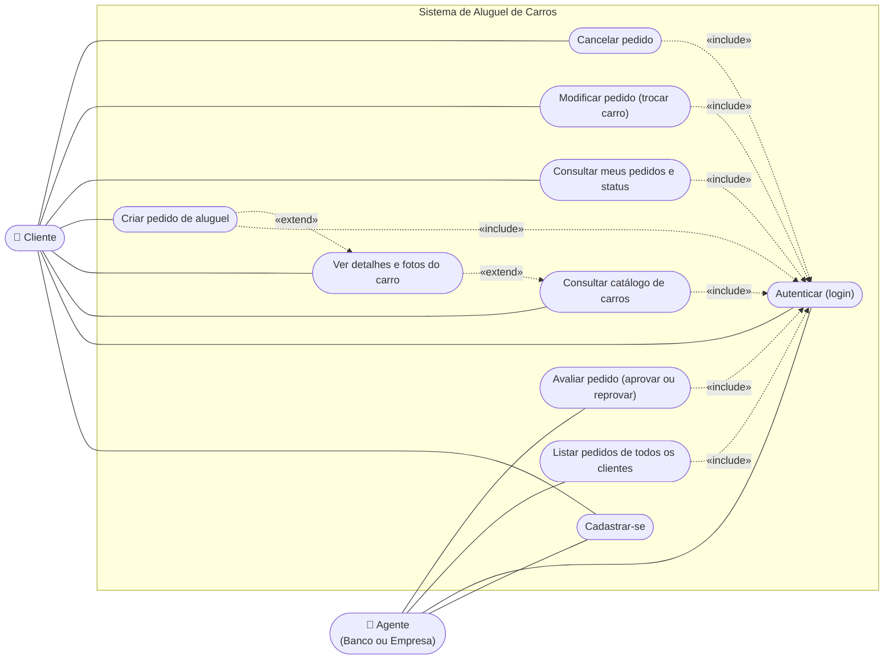

# Diagrama de Casos de Uso

Sistema de Aluguel de Carros (Getaway Car Rentals).

## Atores

| Ator | Descrição |
|---|---|
| **Cliente** | Usuário individual que solicita, modifica, consulta e cancela pedidos de aluguel. |
| **Agente** | Banco ou empresa que analisa financeiramente e avalia os pedidos. |

## Diagrama

## Regras que o diagrama representa

- Todo caso de uso, exceto **Cadastrar-se** e **Autenticar**, exige login (`«include»` Autenticar).
- **Modificar** e **Cancelar** só são permitidos enquanto o pedido está `Pendente`.
- **Avaliar** só é permitido para pedidos `Pendente` e resulta em `Aprovado` ou `Reprovado`.
- O Cliente só enxerga os próprios pedidos; o Agente enxerga todos.
