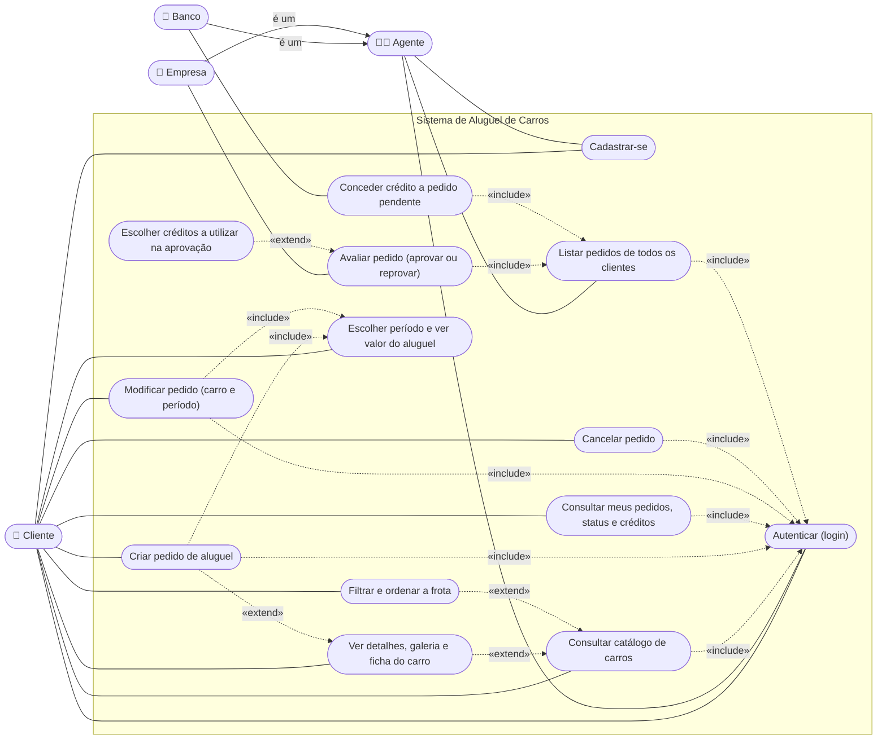

# Diagrama de Casos de Uso

Sistema de Aluguel de Carros (Getaway Car Rentals).

## Atores

| Ator | Descrição |
|---|---|
| **Cliente** | Usuário individual que solicita, modifica, consulta e cancela pedidos de aluguel. |
| **Agente** | Ator geral dos agentes aderentes. Cadastra-se, autentica-se e lista os pedidos de todos os clientes com os dados financeiros. |
| **Banco** | Agente que concede crédito aos pedidos pendentes. |
| **Empresa** | Agente que avalia os pedidos: aprova (com ou sem crédito) ou reprova. |

`Banco` e `Empresa` são especializações de `Agente`: herdam os casos de uso dele e cada um tem a sua ação própria.

## Diagrama

## Regras que o diagrama representa

- Todo caso de uso, exceto **Cadastrar-se** e **Autenticar**, exige login (`«include»` Autenticar).
- O Cliente só enxerga os próprios pedidos; os agentes enxergam todos.
- **Criar pedido** exige escolher o período (retirada e devolução). A diária é **0,3% do valor do veículo** e o total (diária × dias) é calculado no servidor.
- **Modificar** e **Cancelar** só são permitidos enquanto o pedido está `Pendente`. Modificar o pedido **apaga os créditos já concedidos**, porque eles valiam para o carro e o valor anteriores.
- **Conceder crédito** só é permitido a agente do tipo `Banco`, para pedido `Pendente`. Vários bancos podem conceder crédito ao mesmo pedido, mas cada banco concede uma única vez.
- **Avaliar** só é permitido a agente do tipo `Empresa`, para pedido `Pendente`, e resulta em `Aprovado` ou `Reprovado`.
- Ao aprovar, a empresa pode **escolher um ou mais créditos concedidos** para utilizar (`«extend»`) ou aprovar diretamente, sem crédito. A aprovação não depende de existir crédito.

## Histórico de revisões

| Versão | Mudança |
|---|---|
| 1 | Atores Cliente e Agente; avaliação por qualquer agente e crédito por banco em pedido já aprovado. |
| 2 | Inclusão do período do aluguel, do valor calculado e dos filtros da frota. |
| 3 | Separação dos papéis: banco só concede crédito (em pedido pendente, vários bancos por pedido) e empresa avalia, escolhendo os créditos a utilizar. |
