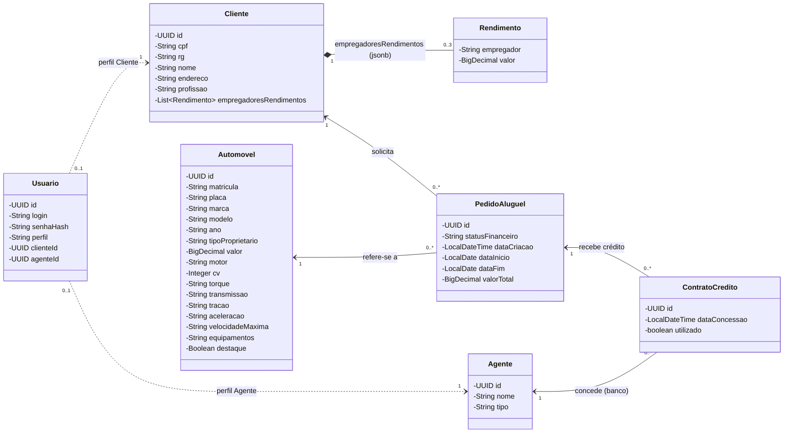
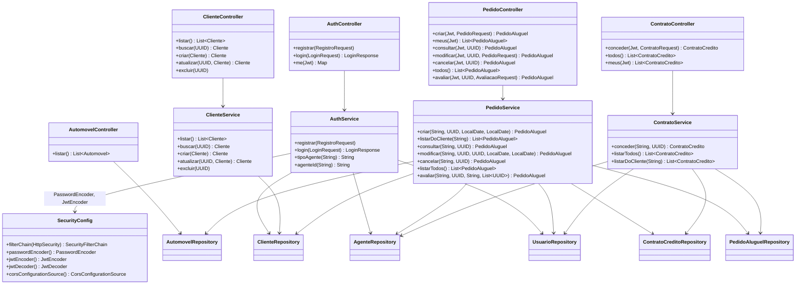

# Diagrama de Classes

## 1. Modelo de domínio (entidades)

Corresponde às classes do pacote `com.example.demo.models` e às tabelas do Supabase.

**Valores controlados (constraints no banco):**

| Campo | Valores aceitos |
|---|---|
| `Agente.tipo` | `Banco`, `Empresa` |
| `Automovel.tipoProprietario` | `Cliente`, `Empresa`, `Banco` |
| `PedidoAluguel.statusFinanceiro` | `Pendente`, `Aprovado`, `Reprovado`, `Cancelado` |
| `Usuario.perfil` | `Cliente`, `Agente` |

**Observações de modelagem:**

- `Rendimento` não é tabela: é guardado como `jsonb` dentro de `clientes`, com limite de 3 validado no `AuthService` e no `ClienteService`.
- `Usuario` referencia `Cliente` ou `Agente` por UUID (`clienteId` / `agenteId`), sem `@ManyToOne`. Exatamente um dos dois é preenchido, conforme o perfil.
- `ContratoCredito` é concedido por agente `Banco` para pedido `Pendente`. Um pedido pode ter vários créditos, no máximo um por banco (constraint única em `pedido_id` + `banco_agente_id`). Implementado em `ContratoService` e `ContratoController` (HU13).
- `ContratoCredito.utilizado` fica `true` quando a `Empresa`, ao aprovar, escolhe usar aquele crédito (`PedidoService.avaliar`, HU20). Aprovar sem escolher nenhum é permitido.
- Quando o cliente modifica o pedido, os créditos já concedidos são apagados (`PedidoService.modificar`), porque valiam para o carro e o valor anteriores.
- O tipo do agente (`Banco` ou `Empresa`) não vai no token: é lido do banco a cada ação, em `ContratoService.conceder` e `PedidoService.avaliar`.
- **Regra de preço:** diária = 0,3% de `Automovel.valor`; `PedidoAluguel.valorTotal` = diária × dias do período. O cálculo é feito em `PedidoService.aplicarPeriodo`, nunca no navegador.

## 2. Camadas (MVC no back-end)

Todos os repositories estendem `JpaRepository<Entidade, UUID>`. Três têm consultas extras:

- `UsuarioRepository`: `findByLogin`, `existsByLogin`
- `PedidoAluguelRepository`: `findByClienteIdOrderByDataCriacaoDesc`, `findAllByOrderByDataCriacaoDesc`
- `ContratoCreditoRepository`: `existsByPedidoIdAndBancoAgenteId`, `findByPedidoId`, `findByPedidoClienteId`, `findAllByOrderByDataConcessaoDesc`

## 3. Autorização por perfil

| Endpoint | Cliente | Banco | Empresa |
|---|:---:|:---:|:---:|
| `POST /api/auth/registrar`, `POST /api/auth/login` | público | público | público |
| `GET /api/automoveis`, `GET /api/me` | ✅ | ✅ | ✅ |
| `POST /api/pedidos`, `GET /api/pedidos/meus`, `GET /api/pedidos/{id}` | ✅ | ❌ 403 | ❌ 403 |
| `PUT /api/pedidos/{id}`, `PUT /api/pedidos/{id}/cancelar` | ✅ | ❌ 403 | ❌ 403 |
| `GET /api/pedidos` | ❌ 403 | ✅ | ✅ |
| `PUT /api/pedidos/{id}/avaliacao` | ❌ 403 | ❌ 403 | ✅ |
| `/api/clientes/**` | ❌ 403 | ✅ | ✅ |
| `POST /api/contratos` | ❌ 403 | ✅ | ❌ 403 |
| `GET /api/contratos` | ❌ 403 | ✅ | ✅ |
| `GET /api/contratos/meus` | ✅ | ❌ 403 | ❌ 403 |

O perfil (`Cliente` ou `Agente`) é verificado com `@PreAuthorize`, a partir do token. A distinção entre `Banco` e `Empresa` é verificada dentro dos services, consultando o agente no banco.
