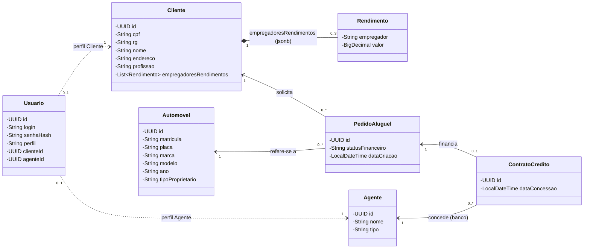
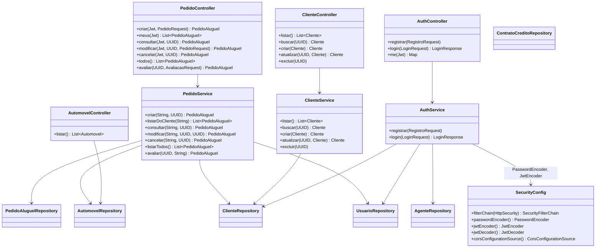

# Diagrama de Classes

## 1. Modelo de domínio (entidades)

Corresponde às classes do pacote `com.example.demo.models` e às tabelas do Supabase.

**Valores controlados (constraints no banco):**

| Campo | Valores aceitos |
|---|---|
| `Agente.tipo` | `Banco`, `Empresa` |
| `Automovel.tipoProprietario` | `Cliente`, `Empresa`, `Banco` |
| `PedidoAluguel.statusFinanceiro` | `Pendente`, `Aprovado`, `Reprovado`, `Cancelado` |
| `Usuario.perfil` | `Cliente`, `Agente` |

**Observações de modelagem:**

- `Rendimento` não é tabela: é guardado como `jsonb` dentro de `clientes`, com limite de 3 validado no `AuthService` e no `ClienteService`.
- `Usuario` referencia `Cliente` ou `Agente` por UUID (`clienteId` / `agenteId`), sem `@ManyToOne`. Exatamente um dos dois é preenchido, conforme o perfil.
- `ContratoCredito` está modelado e tem tabela, mas ainda não tem service nem endpoint (ver HU13).

## 2. Camadas (MVC no back-end)

Todos os repositories estendem `JpaRepository<Entidade, UUID>`. Dois têm consultas extras:

- `UsuarioRepository`: `findByLogin`, `existsByLogin`
- `PedidoAluguelRepository`: `findByClienteIdOrderByDataCriacaoDesc`, `findAllByOrderByDataCriacaoDesc`

## 3. Autorização por perfil

| Endpoint | Cliente | Agente |
|---|:---:|:---:|
| `POST /api/auth/registrar`, `POST /api/auth/login` | público | público |
| `GET /api/automoveis` | ✅ | ✅ |
| `POST /api/pedidos`, `GET /api/pedidos/meus`, `GET /api/pedidos/{id}` | ✅ | ❌ 403 |
| `PUT /api/pedidos/{id}`, `PUT /api/pedidos/{id}/cancelar` | ✅ | ❌ 403 |
| `GET /api/pedidos`, `PUT /api/pedidos/{id}/avaliacao` | ❌ 403 | ✅ |
| `/api/clientes/**` | ❌ 403 | ✅ |
