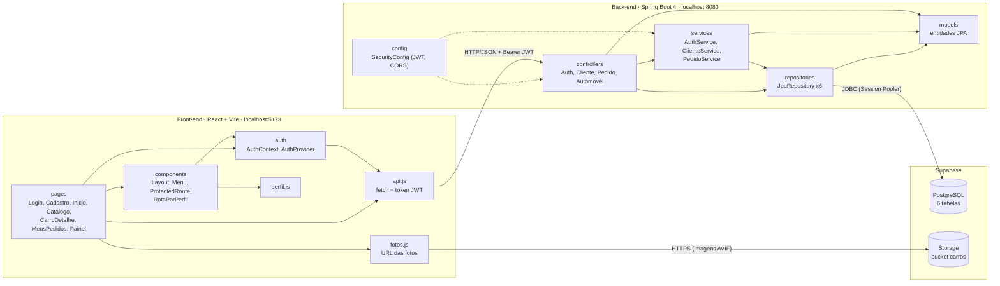
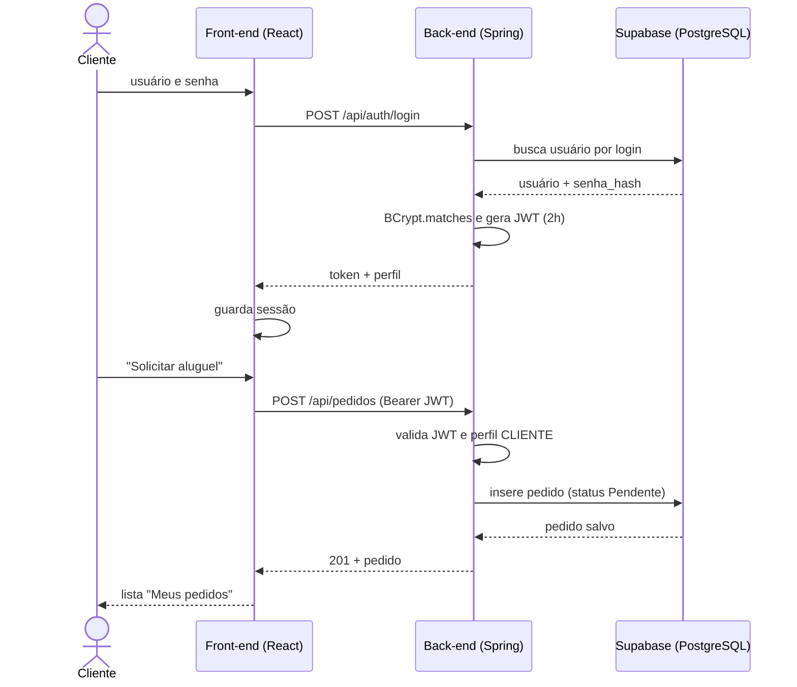

# Diagrama de Pacotes (Visão Lógica)

O sistema tem dois subsistemas, como descrito no enunciado: **gestão de pedidos e contratos** (back-end) e **construção dinâmica das páginas web** (front-end).

## Visão geral

## Pacotes do back-end (`com.example.demo`)

| Pacote | Responsabilidade | Depende de |
|---|---|---|
| `controllers` | Endpoints REST e regras de acesso por perfil (`@PreAuthorize`). | `services`, `repositories`, `models` |
| `services` | Regras de negócio (limite de 3 rendimentos, status do pedido, posse do pedido). | `repositories`, `models` |
| `repositories` | Acesso a dados via Spring Data JPA. | `models` |
| `models` | Entidades persistentes mapeadas para as tabelas. | (nenhum) |
| `config` | Segurança: BCrypt, emissão e validação de JWT, CORS. | Spring Security |

Regra de dependência: as setas vão sempre de cima para baixo (`controllers` → `services` → `repositories` → `models`). Nenhuma camada inferior conhece a superior.

> Observação: `AutomovelController` e `AuthDtos` (no pacote `controllers`) acessam o repository e os DTOs diretamente. É aceitável para leitura simples, mas um `AutomovelService` seria o desenho mais fiel ao MVC.

## Pacotes do front-end (`frontend/src`)

| Pacote / arquivo | Responsabilidade |
|---|---|
| `pages` | Telas completas, uma por rota. |
| `components` | Peças reutilizáveis e guardas de rota (`ProtectedRoute`, `RotaPorPerfil`). |
| `auth` | Contexto de sessão (login, logout, perfil). |
| `api.js` | Único ponto de comunicação com o back-end; injeta o token e trata 401. |
| `fotos.js` | Monta a URL das fotos no Supabase Storage a partir da matrícula. |
| `perfil.js` | Funções `ehCliente` e `ehAgente`. |

## Fluxo de login e pedido (sequência)

